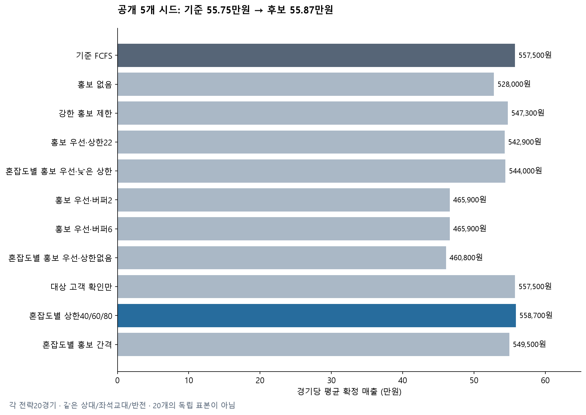
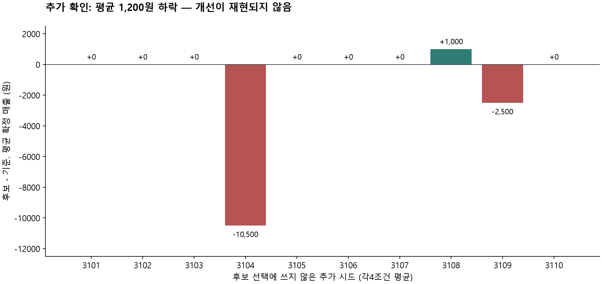
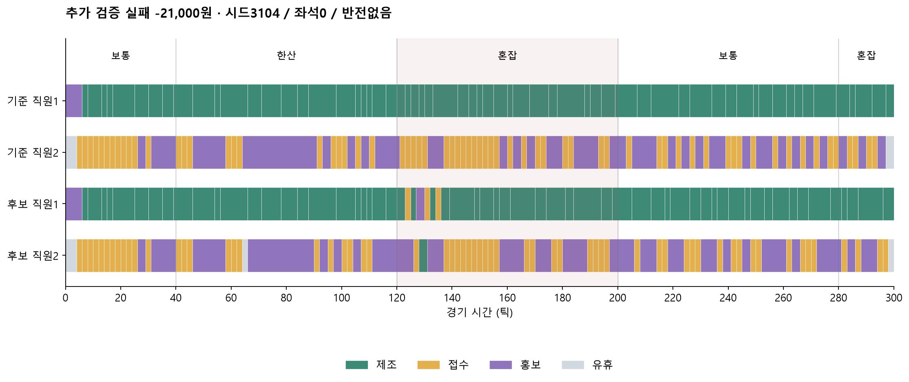

# [홍보·혼잡도·직원 배치] 전략 실험 보고서

- 작성자: 정승빈
- 제출일: 2026-11-22
- 사용 양식: [공통 실험 보고서](../experiment-template.md)
- 실험 기준 커밋: `7882840ba25c96cc290f7135cc8594a32ad74a20`
- 제출 상태: **후보 검토용. 추가 시드에서 개선이 재현되지 않아 기준 전략 유지를 권고합니다.**

## 1. 기준 전략 (Baseline)

- **기존 전략:** 기준 커밋의 `teams/A/MyStrategy.java`를 변경 없이 사용했습니다. 공유 ZIP의 `sources/baseline.java`에 원본을 보관했습니다.
- **기존 전략의 동작 방식:** 진행 중인 직원은 `KEEP`으로 유지합니다. 빈 직원은 제조 → 주문 접수 → 홍보 순서로 배치합니다. 제조·접수할 주문은 각 대기열의 첫 번째 주문을 선택하는 FCFS입니다. 같은 작업 구역에 두 명을 동시에 배치하지 않습니다.
- **개선이 필요한 이유:** 기준 전략은 고객 유무와 혼잡도, 대기 작업량을 홍보 조건에 반영하지 않습니다. 필요한 순간에만 홍보하면 확정 매출을 높일 수 있다는 가설을 세웠습니다. 가설 검증 전부터 개선된 것으로 전제하지 않았습니다.

## 2. 개선 전략

기준을 포함해 아래 11종을 공개 시드에서 비교했습니다. 전략 이름은 CSV의 `strategy` 열과 대응합니다.

| 전략 | 변경한 부분 | 선택 이유 |
|---|---|---|
| 기준 `baseline` | 제조 → 접수 → 홍보, FCFS | 비교의 기준 |
| 전략 A `no-promotion` | 홍보를 하지 않음 | 홍보 자체의 기여 확인 |
| 전략 B `idle-gated` | 작업량 상한 한산8/보통12/혼잡16, 잔여25틱 이하 홍보 중단, 대상 고객 확인 | 홍보의 과도한 제한이 유효한지 확인 |
| 전략 C `buffer-only` | 제조 버퍼6 또는 진행 중 제조 잔여3틱 이상이면 접수보다 홍보 우선, 작업량 상한22 | 제조하는 동안 다른 직원의 배치 비교 |
| 전략 D `traffic-buffer` | 버퍼 기준 한산4/보통6/혼잡8, 작업량 상한16/22/28, 제조 잔여3틱 이상이면 홍보 우선 | 낮은 대기량 상한과 혼잡도 대응 비교 |
| 전략 E `buffer-2` | 제조 배정 후 버퍼2 또는 제조 잔여3틱 이상이면 홍보 우선, 작업량 상한 없음 | 제조 버퍼를 둔 홍보 우선 배치 비교 |
| 전략 F `buffer-6` | 전략 E의 버퍼 기준을6으로 변경 | 버퍼 기준의 민감도 확인 |
| 전략 G `traffic-reserve` | 제조 배정 후 버퍼2/4/6 또는 제조 잔여2/3/4틱 이상이면 홍보 우선, 작업량 상한 없음 | 혼잡도별 직원 배치 비교 |
| 전략 H `nearby-only` | 대상 고객이 있을 때만 홍보 | 대상 확인 조건의 단독 효과 확인 |
| 전략 I `traffic-cap` | 대상 고객 확인 + 작업량 상한 한산40/보통60/혼잡80 | 과도한 홍보 제한을 피한 혼잡도 대응 후보 |
| 전략 J `traffic-cooldown` | 대상 고객 확인 + 한산5/보통4틱 이상 홍보 시작 간격, 혼잡에서는 간격 제한 없음 | 혼잡도별 홍보 빈도 조절 비교 |

- **대상 고객:** 트럭 중심 X=300/900에서 좌우220 이내, 관심도4 미만인 고객입니다. 범위와 관심도 상한은 제공 엔진의 현재 규칙에 근거합니다.
- **작업량 상한:** 주문 개수가 아니라 `view.workload()`가 제공하는 남은 제조 틱 합계입니다. 미접수 주문도 작업량에 포함됩니다.
- 전략 B/C/D는 `now + 25 < horizon`, 나머지 홍보 허용 전략은 기준과 같은 `now + 4 < horizon` 조건을 사용했습니다. 따라서 B/C/D는 단일 요인 분리 실험이 아닌 조합 후보 비교입니다.
- C/D는 새 제조 배정 전 버퍼값, E/F/G는 배정한 제조시간을 뺀 버퍼값을 사용합니다. E/F는 이번 공개 조건에서 결과가 동일했습니다.
- 주문 선택 순서 FCFS는 유지했습니다. 일부 후보에서는 홍보와 접수의 **직원 배정 우선순위**만 달라집니다. 최종 후보 I는 기준의 제조 → 접수 → 홍보 순서를 유지합니다.

## 3. 실험 환경

- **게임 실행 방법:** 제공 `run.js`의 `match()`를 외부 하네스 `benchmark.cjs`에서 호출했습니다. JDK 25.0.4.1로 Java17 대상 컴파일, Node.js 24.21.0, Windows 환경입니다.
- **사용한 시드:** 후보 선택용2026~2030(5개), 후보 고정 후 추가 확인용3101~3110(10개)입니다. 추가 결과를 보고 매개변수를 재조정하지 않았습니다.
- **상대 전략:** 기준 커밋의 원본 A 전략을 고정 상대팀으로 사용했습니다. 당시 저장소에 `teams/B/MyStrategy.java`가 없어 제공 명령 `node run.js --benchmark`를 그대로 쓸 수 없었습니다. 공식 상대 B를 임의로 복원한 실험이 아닙니다.
- **경기 시간 및 혼잡도 조건:** 300틱. 제공 `competition(seed)`가 정한 혼잡도 일정을 그대로 사용했습니다. 전략은 현재 `trafficLevel`만 읽으며 미래 혼잡도 일정은 읽지 않습니다.
- **A/B 위치 교체 여부:** 모든 전략·시드에서 좌석0/1 × 좌우반전false/true의4조건을 모두 비교했습니다.
- **기타 고정 조건:** 엔진·실행기·평가기·메뉴·경기 규칙을 변경하지 않았습니다. 각 경기에서 새 Java 프로세스를 사용했습니다.
- **경기 수:** 공개11종 × 5시드 × 4조건 =220경기, 추가2종 × 10시드 × 4조건 =80경기, 합계300경기입니다. 대표 리플레이 생성용4경기는 이 수에 포함하지 않았습니다.
- **독립성 주의:** 같은 시드의 좌석·반전은 대응 조건입니다. 서로 다른 시드는15개이며300개의 독립 표본으로 해석하지 않습니다.
- **검증:** 300경기에서 양쪽 팀 실행 오류가 없음을 확인했습니다. 최종 후보의14개 경계·배치 검사, 대표4개 리플레이 종료 프레임·간트차트·JavaScript 오류 검사도 통과했습니다.

## 4. 실험 결과

값은 해당 전략 한 팀의 경기당 평균이다. 미완료는 미결제 대기 주문도 포함한다. 환불은 결제 후 제조하지 못한 금액이며 미완료 건수와 같은 개념이 아니다.

### 공개 시드 — 후보 선택
| 전략 | 경기 수 | 평균 확정 매출(원) | 기준 대비 | 완료(건) | 미완료(건) | 환불액(원) | 오류 |
|---|---:|---:|---:|---:|---:|---:|---:|
| 기준 FCFS | 20 | 557,500 | +0.00% | 65.10 | 6.40 | 59,000 | 0 |
| 홍보 없음 | 20 | 528,000 | -5.29% | 59.50 | 4.00 | 43,300 | 0 |
| 강한 홍보 제한 | 20 | 547,300 | -1.83% | 63.40 | 4.50 | 44,200 | 0 |
| 제조 중 홍보 우선·상한22 | 20 | 542,900 | -2.62% | 63.60 | 4.40 | 47,900 | 0 |
| 혼잡도별 홍보 우선·낮은 상한 | 20 | 544,000 | -2.42% | 62.20 | 4.30 | 45,100 | 0 |
| 홍보 우선·버퍼2 | 20 | 465,900 | -16.43% | 53.90 | 6.10 | 16,800 | 0 |
| 홍보 우선·버퍼6 | 20 | 465,900 | -16.43% | 53.90 | 6.10 | 16,800 | 0 |
| 혼잡도별 홍보 우선·상한없음 | 20 | 460,800 | -17.35% | 54.00 | 6.50 | 20,900 | 0 |
| 대상 고객 확인만 | 20 | 557,500 | +0.00% | 65.10 | 6.40 | 59,000 | 0 |
| 혼잡도별 상한40/60/80 | 20 | 558,700 | +0.22% | 64.90 | 6.30 | 56,800 | 0 |
| 혼잡도별 홍보 간격 | 20 | 549,500 | -1.43% | 64.40 | 6.00 | 55,200 | 0 |

### 추가 10개 시드 — 후보 고정 후 확인
| 전략 | 경기 수 | 평균 확정 매출(원) | 기준 대비 | 완료(건) | 미완료(건) | 환불액(원) | 오류 |
|---|---:|---:|---:|---:|---:|---:|---:|
| 기준 FCFS | 40 | 566,550 | +0.00% | 62.30 | 6.55 | 51,800 | 0 |
| 혼잡도별 상한40/60/80 | 40 | 565,350 | -0.21% | 62.10 | 6.50 | 51,600 | 0 |

## 5. 결과 분석

- **가장 좋은 성능을 보인 전략:** 공개 시드에서는 전략 I(`traffic-cap`)가558,700원으로 가장 높았습니다. 추가10개 시드에서 비교한 기준과 I 중에서는 기준 전략이566,550원으로 더 높았습니다.
- **기준 전략 대비 성능 변화:** 공개557,500 →558,700원으로 +1,200원(+0.22%). 추가566,550 →565,350원으로 -1,200원(-0.21%)입니다. 추가40조건에서 후보 우세2/동률32/열세6이며, 이40조건 역시 독립 표본 수는 아닙니다.
- **해당 결과가 나온 이유:** 대상 고객 확인만 적용한 H는 공개 결과가 기준과 같았습니다. 홍보를 없앤 A는 유휴가 평균199.4직원틱으로 늘었고, 상한 없는 홍보 우선 배치는 홍보243.9~244.2직원틱으로 늘었지만 매출은 약46만원으로 떨어졌습니다. 홍보 시간 또는 유휴시간만 최적화해서는 확정 매출이 높아지지 않았습니다.
- **해석의 한계:** 홍보 조건은 고객의 관심도·구매·트럭 선택을 바꾸고 이후 주문 구성도 달라지게 합니다. 관측 결과만으로 각 조건의 일반적인 인과 효과나 최적 임계값을 입증하지 못했습니다. 공식 비공개 시드와 다른 상대 전략은 확인하지 않았습니다.

## 6. 실패 사례 및 개선점

- **성능이 낮아진 상황:** 추가 시드3104, 후보 좌석0, 반전없음에서 기준572,000원 →후보551,000원으로21,000원 하락했습니다.
- **실패 원인:** 첫 작업 차이는 프레임65입니다. 40~120틱 구간의 홍보56→54직원틱, 유휴0→2직원틱 이후, 120~200틱 혼잡 구간에서 제조80→74직원틱, 구간 매출155,000→139,000원으로 줄었습니다. 홍보 제한 뒤 주문 구성과 제조 연속성이 달라진 사례이며, 홍보2틱 감소만이21,000원 손실의 유일한 원인이라고 단정하지 않습니다.
- **보조 지표의 함정:** 이 경기 환불은51,000→50,000원으로 줄었지만 확정 매출은 떨어졌습니다. 환불 감소만으로 전략을 채택하면 안 됩니다.
- **수정하거나 보완할 부분:** 제조 담당의 마감 판단 및 접수 담당의 대기량 제어와 통합한 뒤 다시 비교해야 합니다. 이번에는 해당 담당의 주문 선택 정책을 변경하지 않았습니다.
- **공개 성공 사례도 함께 기록:** 시드2029, 후보 좌석1, 반전없음에서는569,000→577,000원으로8,000원 증가했습니다. 첫 작업 차이는 프레임213이며200~280틱 구간 매출153,000→161,000원입니다. 이 구간 완료 건수는20→19로 줄었으므로 건수와 매출도 구분해야 합니다.

## 7. 최종 추천 전략

- **최종 선택:** 현재 통합 전략은 기준 FCFS를 유지하도록 권고합니다. 전략 I는 검토용 후보로만 공유합니다.
- **선택 이유:** 공개 시드의 소폭 상승이 별도 시드에서 재현되지 않았습니다. 40/60/80은 검증된 최적값이 아니라 이번 실험값이며 개선됐다고 주장할 근거가 부족합니다.
- **다른 전략과 통합할 때 주의할 점:** 이 PR은 Draft로 유지하고 즉시 main에 병합하지 않습니다. 통합 담당자는 홍보 허용 조건과 직원 배정 부분을 검토하되 다른 담당의 제조·접수 정책을 덮어쓰지 않도록 합니다. 작업 중 KEEP과 동일 구역 중복금지는 반드시 유지합니다. 다른 상대·추가 시드와 통합 전략으로 다시 확인해야 합니다.

## 8. 공유 자료

- **GitHub 브랜치 및 PR 링크:** [feat/promotion-seungbin](https://github.com/MiriKim79/foodtruck-project/tree/feat/promotion-seungbin) / [Draft PR #2](https://github.com/MiriKim79/foodtruck-project/pull/2).
- **전략 코드:** [검토용 MyStrategy.java](../../teams/A/MyStrategy.java). 보고서의 권고는 기준 유지이며, 이 파일은 전략 I의 실험 후보입니다.
- **실험 결과 CSV 링크:** [전략별 평균 summary.csv](../../results/promotion-seungbin/summary.csv), [300경기 results.csv](../../results/promotion-seungbin/results.csv).
- **발표용 그래프:** [공개 매출 비교](../../results/promotion-seungbin/charts/01-public-revenue.png), [추가 시드별 차이](../../results/promotion-seungbin/charts/02-validation-by-seed.png), [직원 시간 배분](../../results/promotion-seungbin/charts/03-worker-allocation.png).
- **리플레이·간트차트 캡처:** [실패 간트차트](../../results/promotion-seungbin/charts/04-gantt-loss.png), [성공 간트차트](../../results/promotion-seungbin/charts/05-gantt-gain.png), [실제 리플레이 간트 화면](../../results/promotion-seungbin/charts/06-replay-gantt-capture.png), [실제 정산 화면](../../results/promotion-seungbin/charts/07-replay-settlement-capture.png).
- **전체 재현·발표 자료:** [공유 ZIP 다운로드](../../results/promotion-seungbin/seungbin-promotion-materials.zip). 실험11종 소스, 원본 기준 소스, 재현 하네스, 대표 리플레이 HTML4개와 JSON, 발표용 설명을 포함합니다. GitHub에서 ZIP의 Raw/Download를 눌러 내려받은 뒤 압축을 풀어 사용합니다.
- **실행 기록:** [공개 1차](../../results/promotion-seungbin/public.json), [홍보 우선 비교](../../results/promotion-seungbin/reserve.json), [홍보 조건 비교](../../results/promotion-seungbin/gated.json), [추가 확인](../../results/promotion-seungbin/validation.json), [14개 경계 검사](../../results/promotion-seungbin/unit-test.txt), [리플레이 검사](../../results/promotion-seungbin/replay-ui-checks.json).
- **발표용 핵심 요약 (2~3문장):** 홍보를 줄이거나 먼저 시키는 것만으로 확정 매출은 높아지지 않았습니다. 혼잡도별 작업량 제한은 공개5개 시드에서0.22% 상승했지만 추가10개 시드에서0.21% 하락했습니다. 따라서 현재는 기준 전략을 유지하고 제조·접수 담당 전략과 통합한 뒤 재검증할 것을 권고합니다.
